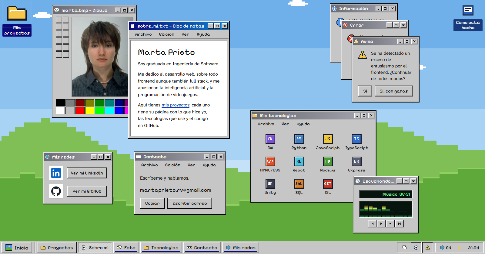
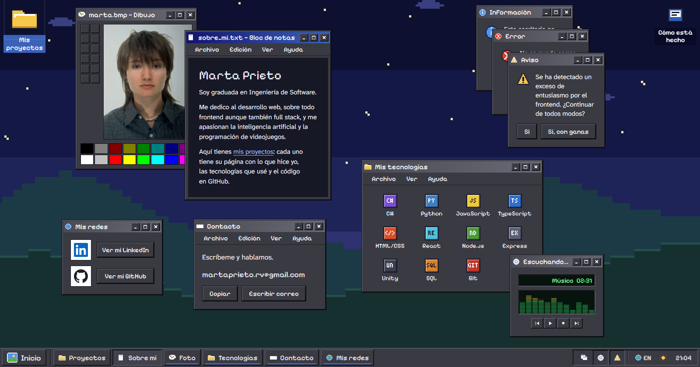
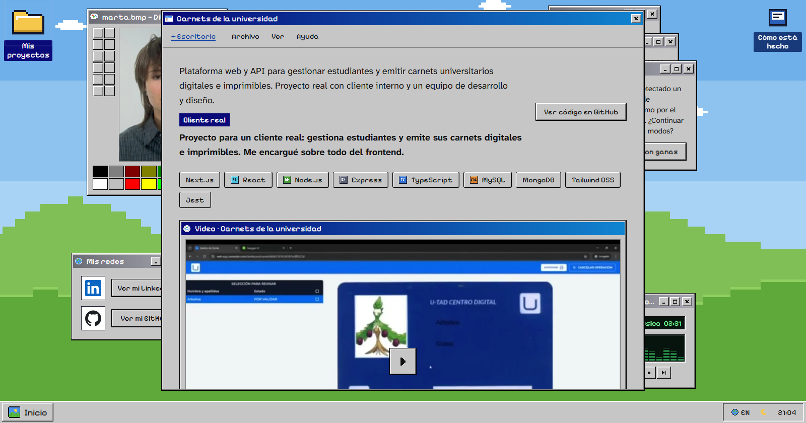
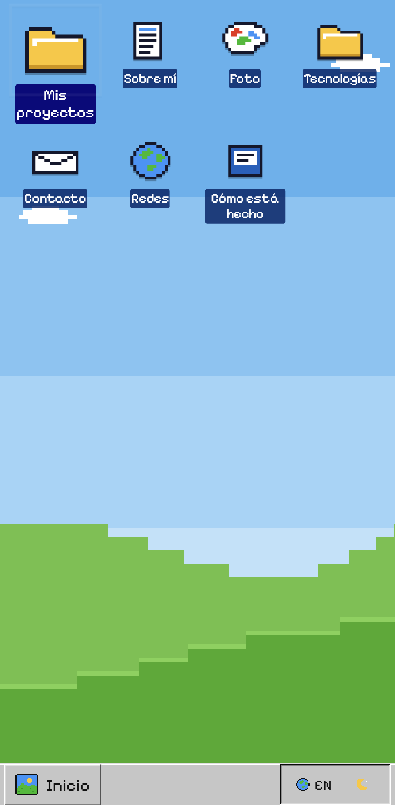

# Portfolio de Marta Prieto

Mi portfolio es un **escritorio retro estilo Windows 98** sobre colinas de píxeles: las ventanas se arrastran, se minimizan y se maximizan, hay menú Inicio y barra de tareas, y cada proyecto se abre como una ventana grande con su propia URL.

**Web:** https://marta-prv.github.io · Español e inglés · Modo claro y oscuro



| Modo oscuro | Proyecto | Móvil |
| --- | --- | --- |
|  |  |  |

## Qué incluye

- Ventanas arrastrables, con orden de apertura, minimizar, maximizar y cerrar; las posiciones se recuerdan durante la sesión.
- Barra de tareas, menú Inicio con submenús y botón "Recolocar".
- Explorador "Mis proyectos", ventanas de tecnologías, contacto, redes y extras decorativos con humor.
- En móvil se convierte en una rejilla de iconos con ventanas a pantalla completa (solo CSS, con `:target`).
- Español (`/`) e inglés (`/en/`), con `hreflang`, sitemap, Open Graph, Twitter Cards y JSON-LD `Person`.

## Tecnologías

Astro · MDX con content collections tipadas (Zod) · Expressive Code · CSS con variables (sin framework) · TypeScript estricto · Playwright + axe · GitHub Actions y GitHub Pages.

JavaScript mínimo y sin librerías: solo un gestor de ventanas en vanilla TypeScript ([src/scripts/windowManager.ts](src/scripts/windowManager.ts)). Todo el contenido está en el HTML del servidor.

## Decisiones de diseño

- **Inspirado en Windows 98, sin copiarlo**: fondos, iconos y nombres propios (sin logos ni fuentes de Microsoft). Las únicas marcas son los logos de LinkedIn y GitHub, para enlazar a mis perfiles.
- **Arrastrar es un extra**: todo está colocado y legible al entrar, y el teclado nunca depende de arrastrar. Un reclutador llega a un proyecto en un clic o con Tab + Enter.
- **Sin pantalla de arranque**: retrasaría el primer contenido.
- **Sin router en cliente**: abrir un proyecto es una carga de página normal, con URL y SEO reales.
- **Accesibilidad**: contraste AA en claro y oscuro, foco visible, objetivos táctiles de 44 px, `prefers-reduced-motion` respetado, auditoría con axe en los tests.
- **Rendimiento**: imágenes optimizadas con `astro:assets` (WebP), fuentes autoalojadas con `font-display: swap` y precarga de las críticas, vídeo de YouTube con fachada (no se pide nada a YouTube hasta pulsar play).

El sistema de diseño completo está en [DESIGN.md](DESIGN.md) y el briefing en [docs/BRIEFING.md](docs/BRIEFING.md).

## Cómo ejecutarlo

Requiere Node.js 22 o superior.

```sh
npm install
npm run dev        # servidor local en http://localhost:4321
npm run build      # compila en dist/ y valida los proyectos
npm run preview    # sirve dist/
npm test           # tests de Playwright (escritorio y móvil, incluye axe)
```

La primera vez que ejecutes los tests: `npx playwright install chromium`.

Otros scripts: `npm run og` (regenera la imagen de vista previa), `npm run favicon` y `npm run screenshots` (capturas de este README). Los tres necesitan `npm run preview` en marcha.

## Cómo añadir un proyecto

Crea **dos archivos con el mismo nombre**, uno por idioma:

```
src/content/projects/es/mi-proyecto.mdx
src/content/projects/en/mi-proyecto.mdx
```

El frontmatter se valida en [src/content.config.ts](src/content.config.ts) (título, resumen, categoría, icono, frase de impacto, tecnologías, repositorio, vídeo y portada opcionales, orden). Si falta algo, `npm run build` falla con un mensaje claro. El proyecto aparece solo en "Mis proyectos" y en el sitemap.

## Estructura

```
src/content/projects/  proyectos en MDX (es/ y en/)
src/components/        ventanas, barra de tareas, iconos pixel
src/data/              datos editables: tecnologías, redes, contacto, avisos…
src/i18n/              textos de la interfaz en ES y EN
src/scripts/           gestor de ventanas
src/styles/            tokens de diseño y colocación de las ventanas
tests/                 Playwright (escritorio, móvil, accesibilidad, SEO)
```

## Despliegue

Cada push a `main` ejecuta [.github/workflows/deploy.yml](.github/workflows/deploy.yml): instala, compila, pasa los tests y publica `dist/` en GitHub Pages.
