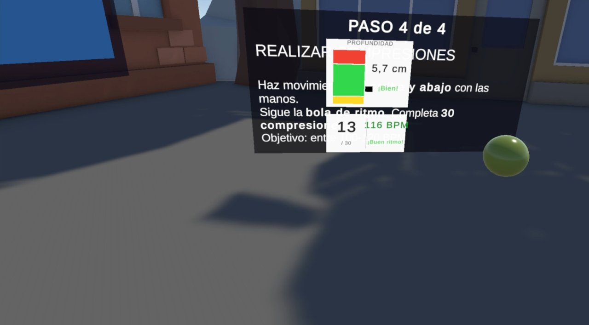

## What it is

**HealthSimVR** is a virtual reality simulator to practise **cardiopulmonary resuscitation (CPR)** step by step, with your own hands. It is built in Unity for Meta Quest 2 and combines **controllers** with **hand tracking**.

It is my **final degree project** for the Software Engineering degree at **U-tad**, individual and supervised by **Daniela Venturo Esaine**.

## The problem

Learning CPR takes a room, an instructor and a manikin, so it is rarely repeated enough. HealthSimVR offers **complementary** training (it does not replace in-person courses): a safe, repeatable environment that also **measures** every run. It rests on three bets:

1. **Hand tracking** for the compressions, to bring the gesture closer to a real emergency.
2. **Quantitative feedback** in real time (depth and rhythm), not just "right / wrong".
3. **A standalone device** (Meta Quest 2), with no specific infrastructure.

It is not a clinical product and has not been validated with users: it is a **working prototype**. Educational validation is left as future work.

## What I did

The project is **individual**: I designed and built it from start to finish.

- Analysis and design of the experience and of the two scenes.
- A modular, event-based architecture and a training state machine.
- All 18 C# scripts: compression detection, rhythm calculation, dialogue system, checklist, world-space UI and scene management.
- Unity, XR and hand tracking setup, and threshold calibration through testing on the headset.
- The thesis report.

The 3D models and environments are **third-party assets**.

## How it works

The CPR scene is guided and **strictly sequential**: no step can be skipped.

1. **Check the patient:** hold your hand for 5 s over the head (consciousness) and over the mouth (breathing).
2. **Call 112:** pick up the phone, dial and turn on speaker.
3. **Place your hands** on the centre of the chest.
4. **Do 30 compressions**, with a 110 BPM rhythm guide and a panel showing depth and BPM.
5. **Results:** compressions, average BPM, % of correct depth and rhythm, and an overall rating.

There is also a start scene with a nurse who acts as a guide, an always-visible checklist and a CSV export of the session.



## How it is built

A **modular, event-based architecture**: each module does one thing and talks to the others by emitting and listening to events. At its centre is a **state machine** that stops you moving on before the current phase is done.

```csharp title="TrainingStateMachine.cs"
public bool TryCompleteStep(TrainingState stepToComplete)
{
    if (stepToComplete != currentState) return false;   // out-of-order action
    OnStepCompleted?.Invoke(currentState);
    // ... moves on to the next state in the sequence
}
```

Compressions are detected by analysing the hand's height every frame (peak, valley, recovery). Measured with the Profiler on a Meta Quest 2 through Quest Link, it runs at about **71 stable FPS** (the device target is 72).

## The challenges

- **Hand tracking accuracy.** The Quest 2's hand tracking loses precision with fast, repetitive movements, which is exactly what compressions are. I calibrated the thresholds with values more permissive than the clinical ones (3 cm instead of the recommended 5–6 cm) after several rounds of testing on the headset.
- **Tracking noise.** A higher recovery threshold produced false positives; I smoothed the panel values with linear interpolation to balance stability and responsiveness.
- **Collisions on compound objects.** Each hand generates several collision events. I solved it with a relay component and **enter/exit counters** instead of booleans.
- **Sequential design.** It guarantees the right order, but it does not let you practise a single phase on its own; a free mode is left as a future improvement.

{/* TODO(Marta): añade aquí otros aprendizajes personales (proceso, herramientas, decisiones) si quieres destacarlos */}

## Limits and next steps

No haptic feedback, no 30:2 ventilations or airway opening, only functional evaluation (no user study) and a single training scene. Future work: new scenarios, the full protocol, evaluation with users and other headsets.

The full report (state of the art, methodology, development and conclusions) is behind the **Read thesis (PDF)** button.
