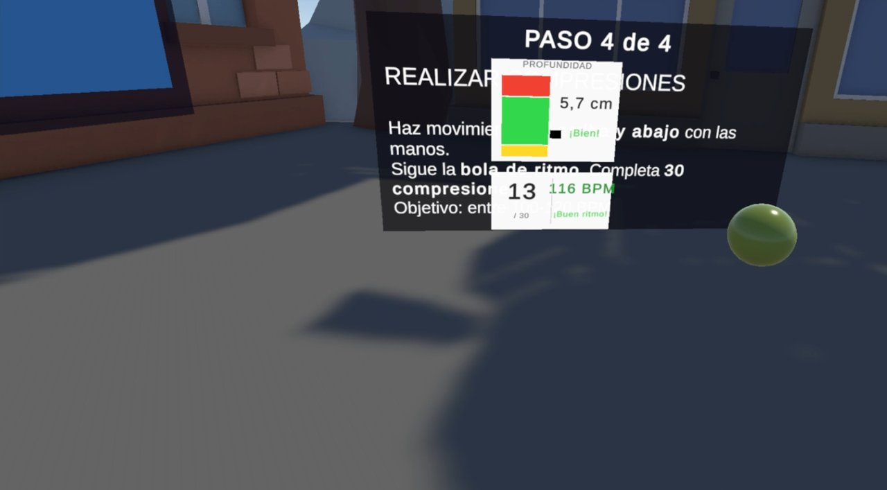

## Qué es

**HealthSimVR** es un simulador de realidad virtual para practicar, paso a paso y con las manos, la maniobra de **reanimación cardiopulmonar (RCP)**. Está hecho en Unity para Meta Quest 2 y combina los **mandos** con el **seguimiento de manos** (*hand tracking*).

Es mi **Trabajo de Fin de Grado** del Grado en Ingeniería de Software en **U-tad**, individual y tutorizado por **Daniela Venturo Esaine**.

## El problema

Aprender RCP exige una sala, un instructor y un maniquí, y por eso casi nunca se repite lo suficiente. HealthSimVR propone un entrenamiento **complementario** (no sustituye a la formación presencial): un entorno seguro y repetible que además **mide** cada ejecución. Se apoya en tres apuestas:

1. **Hand tracking** en las compresiones, para acercar el gesto al de una emergencia real.
2. **Feedback cuantitativo** en tiempo real (profundidad y ritmo), no solo «correcto / incorrecto».
3. **Dispositivo autónomo** (Meta Quest 2), sin infraestructura específica.

No es un producto clínico ni está validado con usuarios: es un **prototipo funcional**. La validación formativa queda como trabajo futuro.

## Qué hice yo

El proyecto es **individual**: lo diseñé y desarrollé de principio a fin.

- Análisis y diseño de la experiencia y de los dos escenarios.
- Arquitectura modular basada en eventos y máquina de estados del entrenamiento.
- Los 18 scripts en C#: detección de compresiones, cálculo del ritmo, sistema de diálogos, checklist, interfaz en el mundo y gestión de escenas.
- Configuración de Unity, XR y *hand tracking*, y calibración de umbrales con pruebas en el visor.
- La memoria del TFG.

Los modelos 3D y los entornos son **assets de terceros**.

## Cómo funciona

La escena de RCP es guiada y **estrictamente secuencial**, sin poder saltarse pasos:

1. **Comprobar al paciente:** mantener la mano 5 s sobre la cabeza (consciencia) y sobre la boca (respiración).
2. **Llamar al 112:** coger el teléfono, marcar y activar el manos libres.
3. **Colocar las manos** en el centro del pecho.
4. **Hacer 30 compresiones**, con guía de ritmo a 110 BPM y un panel con la profundidad y los BPM.
5. **Resultados:** compresiones, BPM medio, % de profundidad y de ritmo correctos y una valoración global.

Además hay una escena de inicio con una enfermera que hace de guía, un checklist siempre visible y una exportación de la sesión a CSV.



## Cómo está montado

Una arquitectura **modular basada en eventos**: cada módulo hace una sola cosa y se comunica emitiendo y escuchando eventos. El eje es una **máquina de estados** que impide avanzar sin completar la fase actual.

```csharp title="TrainingStateMachine.cs"
public bool TryCompleteStep(TrainingState stepToComplete)
{
    if (stepToComplete != currentState) return false;   // acción fuera de orden
    OnStepCompleted?.Invoke(currentState);
    // ... avanza al siguiente estado de la secuencia
}
```

Las compresiones se detectan analizando la altura de la mano en cada fotograma (pico, valle, recuperación). Medido con el Profiler sobre Meta Quest 2 vía Quest Link, rinde unos **71 FPS estables** (el objetivo del dispositivo es 72).

## Los retos

- **Precisión del hand tracking.** El seguimiento de manos del Quest 2 pierde precisión con movimientos rápidos y repetitivos, justo lo que pasa en las compresiones. Calibré los umbrales con valores más permisivos que los clínicos (3 cm frente a los 5–6 cm recomendados) tras varias rondas de pruebas en el visor.
- **Ruido del seguimiento.** Un umbral de recuperación más alto daba falsos positivos; suavicé los valores del panel con interpolación lineal para equilibrar estabilidad y respuesta.
- **Colisiones en objetos compuestos.** Cada mano genera varios eventos de colisión. Lo resolví con un componente de retransmisión y **contadores de entrada y salida** en lugar de booleanos.
- **Diseño secuencial.** Garantiza el orden correcto, pero no deja practicar una fase aislada; un modo libre queda como mejora futura.

{/* TODO(Marta): añade aquí otros aprendizajes personales (proceso, herramientas, decisiones) si quieres destacarlos */}

## Límites y siguientes pasos

Sin retroalimentación háptica, sin ventilaciones 30:2 ni apertura de vía aérea, con evaluación solo funcional (sin estudio con usuarios) y un único escenario de entrenamiento. Como trabajo futuro: nuevos escenarios, protocolo completo, evaluación con usuarios y otros visores.

La memoria completa (estado del arte, metodología, desarrollo y conclusiones) está en el botón **Leer memoria (PDF)**.
